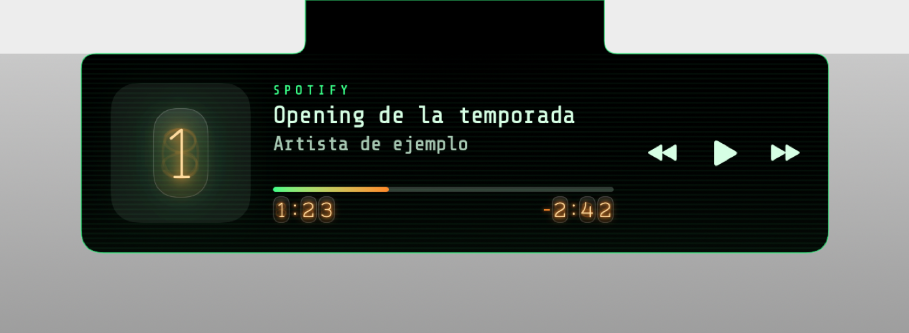
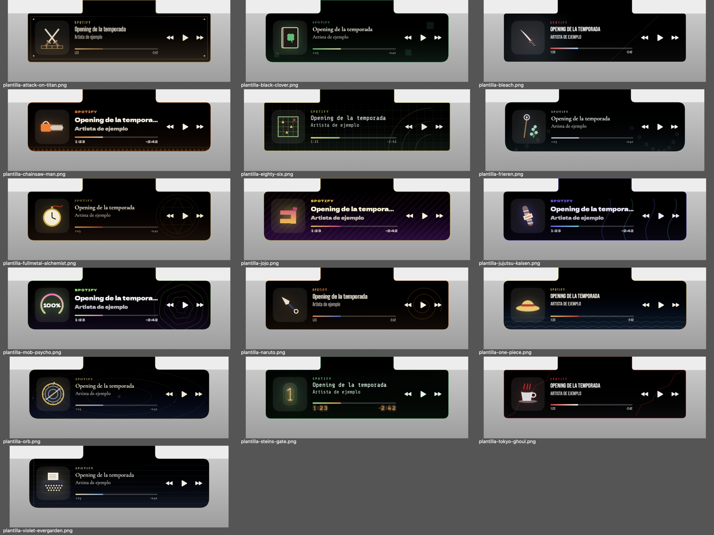
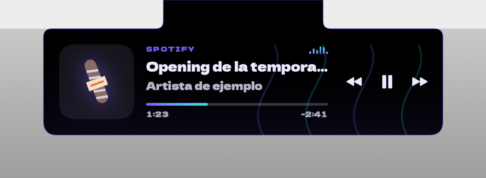
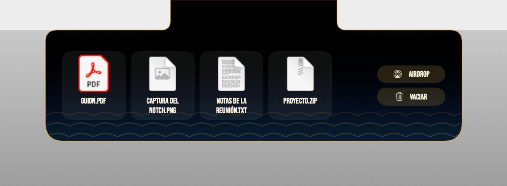
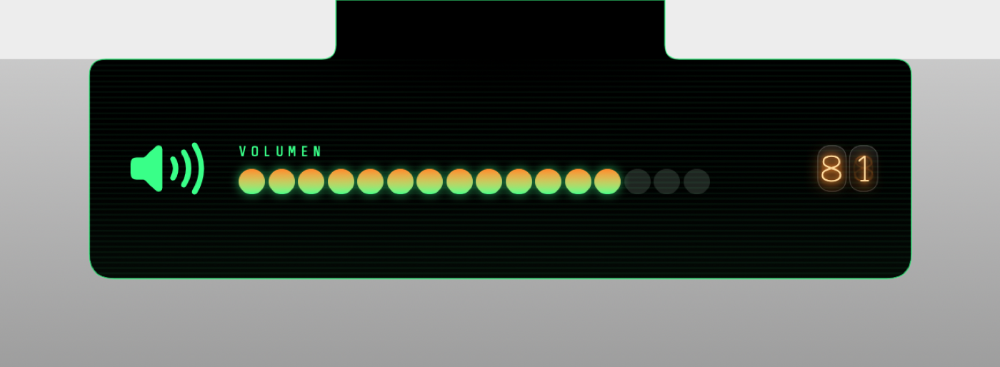

# Notchy

[Español](README.md) · **English**

Notchy turns your MacBook's notch into a living, Dynamic Island–style panel made for anime fans: your music with a visualizer, templates for your favorite series, your own images, GIFs or videos as backgrounds, a file shelf, and battery and volume indicators. It uses 0% CPU when idle.



## What it does

| | |
|---|---|
| **Music** | Artwork, title, artist, progress and controls for any app (Spotify, Music, your browser…). A visualizer that reacts to the real audio. |
| **16 anime templates** | Steins;Gate, Attack on Titan, JoJo's Bizarre Adventure, Bleach, Orb, Tokyo Ghoul, 86, Black Clover, Jujutsu Kaisen, Chainsaw Man, Fullmetal Alchemist, Frieren, One Piece, Naruto, Violet Evergarden and Mob Psycho 100. Each with its own palette, typography, animated opening and iconic object. |
| **Your themes** | Duplicate a template and add your own image, GIF or video of any character. Drag-to-frame, automatic palette, and export/import as `.notchytheme`. |
| **Shelf** | Drag files onto the notch, drag them back out anywhere or share them via AirDrop. |
| **Indicators** | Charger plugged in or out, low battery, fully charged and volume, all in your theme's style. |
| **Automatic themes** | A day theme and a night theme, or a different one per app. |
| **No notch** | On a MacBook Air without a notch, Mac mini, iMac or external displays, a floating pill offers the same features. |



| Visualizer | Shelf | Volume |
|---|---|---|
|  |  |  |

> Notchy doesn't include official art, logos, characters or sounds from any series. The templates only use colors, shapes and free fonts; each user adds their own art from their Mac. Notchy isn't affiliated with the rights holders of any series mentioned.

## Requirements

- macOS 15 Sequoia or later (tested on macOS 27).
- Apple silicon Mac (M1 or later).

## Installation

### With Homebrew

```sh
brew tap YOUR_USER/notchy
brew install --cask notchy
```

### Manual

1. Download `Notchy-x.y.z.zip` from [Releases](../../releases) and unzip it.
2. Drag `Notchy.app` to **Applications**.
3. Open it. It has no Dock icon: it appears in the menu bar and greets you with a welcome window.

To verify the download: `shasum -a 256 -c Notchy-x.y.z.zip.sha256`.

### First launch: the Gatekeeper warning

Notchy is signed with its own certificate, not an Apple one: it isn't notarized because it's distributed without a developer account. The first time, macOS will say it **can't verify** the app. To open it:

1. Double-click Notchy and dismiss the alert with **OK**. Don't move it to the Trash.
2. Open **System Settings → Privacy & Security**.
3. Under **Security** you'll see "Notchy was blocked". Click **Open Anyway** and confirm with your password or Touch ID.

You only need to do this once per manually installed version. Since macOS 15, *Control-click → Open* no longer bypasses this warning. Alternatively, remove the quarantine flag in Terminal:

```sh
xattr -dr com.apple.quarantine /Applications/Notchy.app
```

## Permissions

All optional. Notchy works without them; you only lose that specific feature.

| Permission | What for | Without it |
|---|---|---|
| **Accessibility** | Hide the wings when they collide with the active app's menus, and replace the macOS volume indicator with Notchy's. | The wings don't hide by themselves and you'll see the macOS volume indicator alongside Notchy's. |
| **System audio** | Let the visualizer follow the real music. Notchy only computes the spectrum; nothing is recorded or saved. | The visualizer uses a simulated animation. |
| **Automation (Spotify, Music)** | Only if reading music through MediaRemote fails, to use AppleScript as a fallback. | No fallback if MediaRemote fails. |
| **Login Items** | Open Notchy at login. | You open it yourself. |

> Updates arrive automatically through Sparkle and keep your permissions, because every version is signed with the same certificate.

## Energy use

Notchy uses no timers or polling: everything runs on system events. With the panel collapsed it measures 0.00% CPU and 0 wakeups per minute. Animations, background video and the visualizer only exist while the panel is open. Details in [docs/ENERGIA.md](docs/ENERGIA.md).

## Building

You need the Xcode Command Line Tools (or Xcode).

```sh
./scripts/build-app.sh      # builds build/Notchy.app (ad-hoc signed if you don't have Notchy's certificate)
./scripts/run.sh            # builds and opens the app
./scripts/test.sh           # tests
./scripts/release.sh 1.0.0  # tests + release .zip with its SHA-256 in dist/
```

## Credits and licenses

Full details in [THIRD_PARTY_NOTICES.md](THIRD_PARTY_NOTICES.md).

- **Now Playing:** [MediaRemoteAdapter](https://github.com/ungive/mediaremote-adapter) © 2025 Jonas van den Berg and contributors, BSD-3-Clause.
- **Updates:** [Sparkle](https://sparkle-project.org), MIT license.
- **Fonts** (SIL Open Font License 1.1): Nixie One, Share Tech Mono, Big Shoulders Stencil Display, Dela Gothic One, Bebas Neue and Cormorant Garamond.
- **Inspiration:** [boring.notch](https://github.com/TheBoredTeam/boring.notch). Notchy doesn't reuse any of its code.
