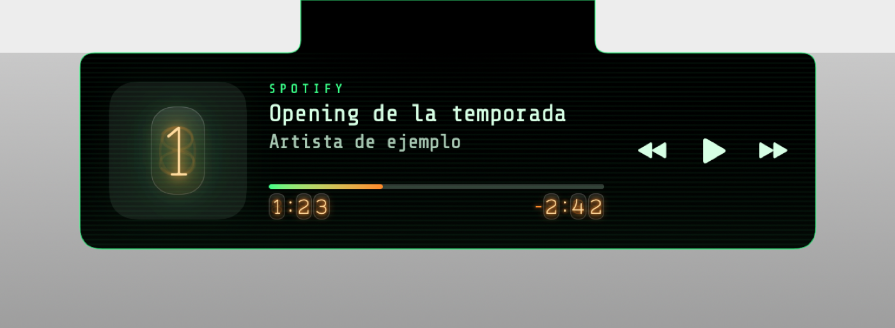
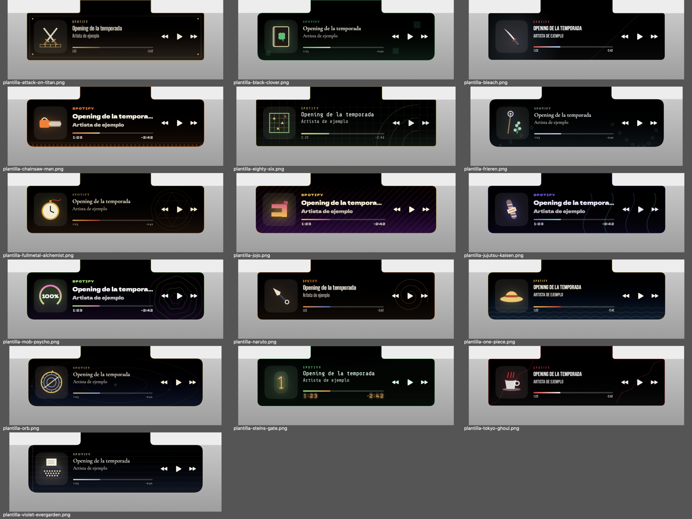
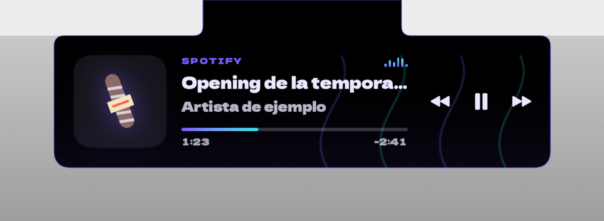
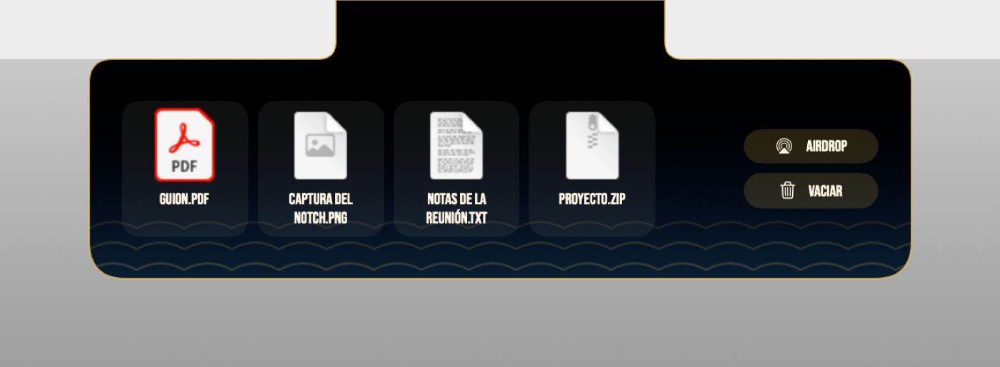
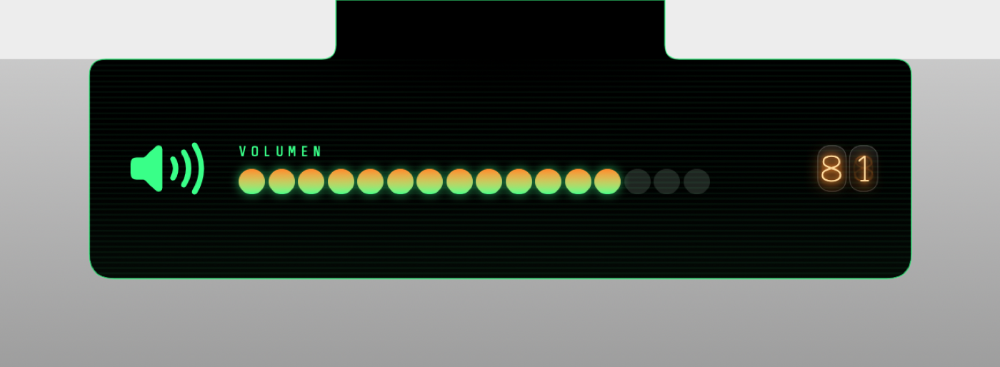

# Notchy

**Español** · [English](README.en.md)

Notchy convierte el notch de tu MacBook en un panel vivo, al estilo Dynamic Island, pensado para fans del anime: tu música con visualizador, plantillas de tus series favoritas, tus propias imágenes, GIF o vídeos de fondo, una estantería de archivos y avisos de batería y volumen. Gasta 0 % de CPU en reposo.



## Qué hace

| | |
|---|---|
| **Música** | Carátula, título, artista, progreso y controles de cualquier app (Spotify, Música, el navegador…). Visualizador que reacciona al audio real. |
| **16 plantillas de anime** | Steins;Gate, Attack on Titan, JoJo's Bizarre Adventure, Bleach, Orb, Tokyo Ghoul, 86, Black Clover, Jujutsu Kaisen, Chainsaw Man, Fullmetal Alchemist, Frieren, One Piece, Naruto, Violet Evergarden y Mob Psycho 100. Cada una con su paleta, tipografía, apertura animada y objeto icónico. |
| **Tus temas** | Duplica una plantilla y pon tu imagen, GIF o vídeo del personaje que quieras. Encuadre arrastrando, paleta automática y exportar/importar como `.notchytheme`. |
| **Estantería** | Arrastra archivos al notch, sácalos arrastrando o compártelos por AirDrop. |
| **Avisos** | Cargador conectado o desconectado, batería baja, carga completa y volumen con el estilo del tema. |
| **Temas automáticos** | Un tema de día y otro de noche, o uno distinto según la app que uses. |
| **Sin notch** | En MacBook Air sin notch, Mac mini, iMac o monitores externos aparece una píldora flotante con las mismas funciones. |



| Visualizador | Estantería | Volumen |
|---|---|---|
|  |  |  |

> Notchy no incluye arte, logos, personajes ni sonidos oficiales de ninguna serie. Las plantillas usan solo colores, formas y tipografías libres; el arte lo pone cada usuario desde su Mac. Notchy no está afiliado a los titulares de ninguna de las series mencionadas.

## Requisitos

- macOS 15 Sequoia o posterior (probado en macOS 27).
- Mac con Apple Silicon (M1 o posterior).

## Instalación

### Con Homebrew

```sh
brew tap TU_USUARIO/notchy
brew install --cask notchy
```

### Manual

1. Descarga `Notchy-x.y.z.zip` desde [Releases](../../releases) y descomprímelo.
2. Arrastra `Notchy.app` a **Aplicaciones**.
3. Ábrela. No tiene icono en el Dock: aparece en la barra de menús y te recibe con una bienvenida.

Para comprobar la descarga: `shasum -a 256 -c Notchy-x.y.z.zip.sha256`.

### La primera vez: aviso de Gatekeeper

Notchy está firmada con un certificado propio, no con uno de Apple: no está notarizada porque se distribuye sin cuenta de desarrollador. La primera vez macOS dirá que **no puede verificar** la app. Para abrirla:

1. Haz doble clic en Notchy y cierra el aviso con **OK**. No la muevas a la papelera.
2. Abre **Ajustes del Sistema → Privacidad y seguridad**.
3. En **Seguridad** verás «Se ha bloqueado el uso de Notchy». Pulsa **Abrir igualmente** y confirma con tu contraseña o Touch ID.

Solo hace falta una vez por versión instalada a mano. Desde macOS 15, *Control + clic → Abrir* ya no evita este aviso. Si lo prefieres, puedes quitar la marca de cuarentena por Terminal:

```sh
xattr -dr com.apple.quarantine /Applications/Notchy.app
```

## Permisos

Todos son opcionales. Sin ellos Notchy funciona; solo se pierde la función concreta.

| Permiso | Para qué | Si no lo das |
|---|---|---|
| **Accesibilidad** | Ocultar las alas cuando chocan con los menús de la app activa y sustituir el aviso de volumen de macOS por el de Notchy. | Las alas no se ocultan solas y verás el aviso de volumen de macOS junto al de Notchy. |
| **Audio del sistema** | Que el visualizador siga la música real. Notchy solo calcula el espectro; no graba ni guarda nada. | El visualizador se anima de forma simulada. |
| **Automatización (Spotify, Música)** | Solo si falla la lectura de la música por MediaRemote, para usar AppleScript como respaldo. | No hay respaldo si MediaRemote falla. |
| **Ítems de inicio** | Abrir Notchy al iniciar sesión. | La abres tú a mano. |

> Las actualizaciones llegan solas con Sparkle y conservan los permisos, porque todas las versiones se firman con el mismo certificado.

## Consumo

Notchy no usa temporizadores ni consultas periódicas: todo funciona por eventos del sistema. Con el panel recogido mide 0,00 % de CPU y 0 despertares por minuto. Las animaciones, el vídeo de fondo y el visualizador solo existen mientras el panel está abierto. Detalle en [docs/ENERGIA.md](docs/ENERGIA.md).

## Compilar

Necesitas las Command Line Tools de Xcode (o Xcode).

```sh
./scripts/build-app.sh      # genera build/Notchy.app (firma ad-hoc si no tienes el certificado de Notchy)
./scripts/run.sh            # compila y abre la app
./scripts/test.sh           # tests
./scripts/release.sh 1.0.0  # tests + .zip de release con su SHA-256 en dist/
```

## Créditos y licencias

Detalle completo en [THIRD_PARTY_NOTICES.md](THIRD_PARTY_NOTICES.md).

- **Now Playing:** [MediaRemoteAdapter](https://github.com/ungive/mediaremote-adapter) © 2025 Jonas van den Berg y colaboradores, BSD-3-Clause.
- **Actualizaciones:** [Sparkle](https://sparkle-project.org), licencia MIT.
- **Tipografías** (SIL Open Font License 1.1): Nixie One, Share Tech Mono, Big Shoulders Stencil Display, Dela Gothic One, Bebas Neue y Cormorant Garamond.
- **Inspiración:** [boring.notch](https://github.com/TheBoredTeam/boring.notch). Notchy no reutiliza código suyo.

## Licencia

Notchy es software libre bajo la [GNU General Public License v3.0](LICENSE). Puedes usarlo, estudiarlo, modificarlo y redistribuirlo; si publicas una versión modificada, también debe ser GPL-3.0 y con su código fuente disponible. Los componentes de terceros conservan sus propias licencias (ver [THIRD_PARTY_NOTICES.md](THIRD_PARTY_NOTICES.md)).
